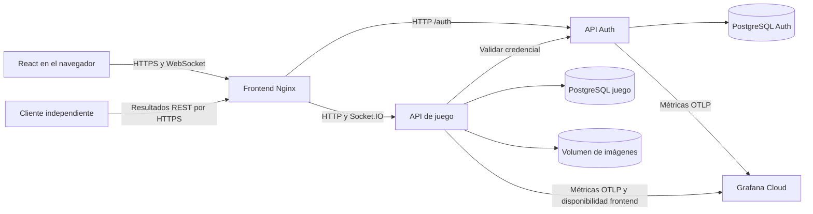
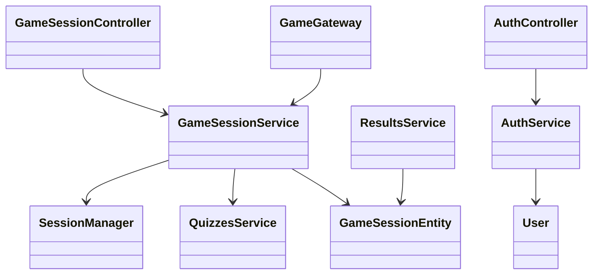
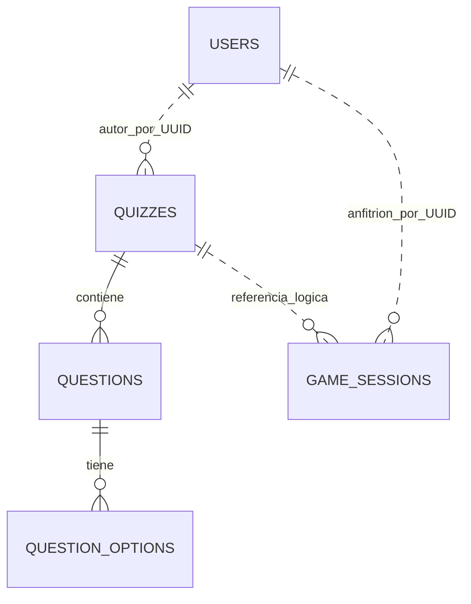

# Arquitectura de ProfeLink

El navegador ejecuta React. En Compose, Nginx sirve el frontend y reenvía
HTTP y Socket.IO a las APIs NestJS. Auth mantiene sus propias cuentas y
emite JWT para la audiencia `kahoot-api`. El backend de juego usa un
monolito modular con slices de cuestionarios, sesiones y resultados. La API
consulta a Auth para verificar la vigencia de una cuenta por red.

El controlador y el gateway traducen la entrada REST y WebSocket. El
servicio de juego coordina permisos, cuestionarios y persistencia, y el
motor en memoria aplica el tiempo, las respuestas únicas y el avance de
rondas. Las sesiones vivas están limitadas a una réplica de la API. Los
resultados terminados se conservan tras reiniciar.

`USERS` pertenece a la base de Auth. Las demás tablas pertenecen a la
base de juego. Los vínculos con Auth usan identificadores UUID sin llaves
foráneas entre bases. `GAME_SESSIONS` guarda un PIN único, estado,
marcas de tiempo y el resultado final como JSONB. Las preguntas
guardan metadatos de la imagen y el archivo reside en el volumen.

- [Despliegue, cuentas de prueba y cliente de resultados](teacher-guests-deployment.md)
- [Contrato REST y eventos en vivo](openapi.json)
- [Configuración y paneles de Grafana](grafana/README.md)
